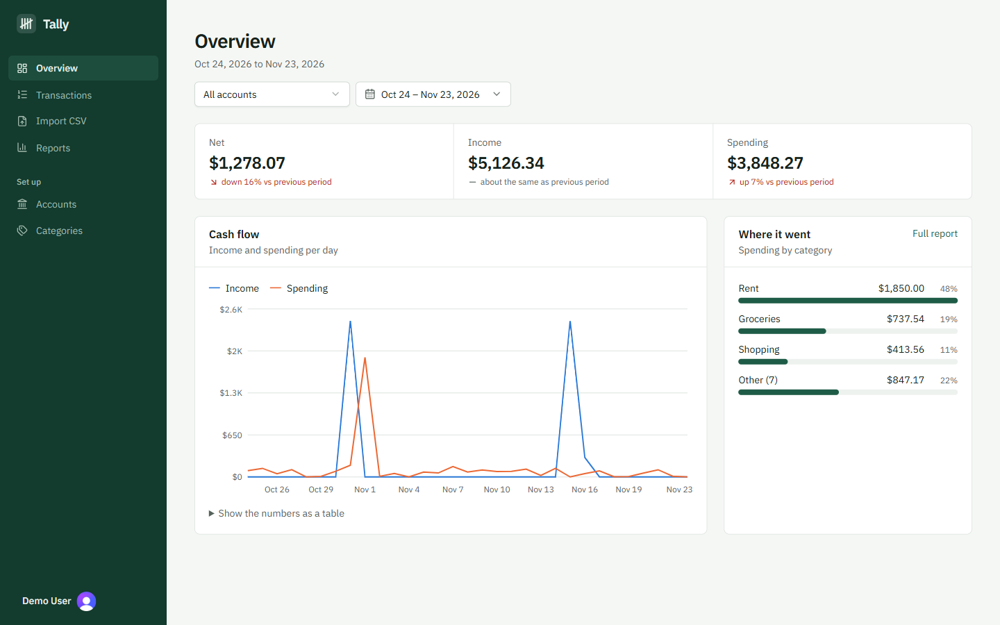
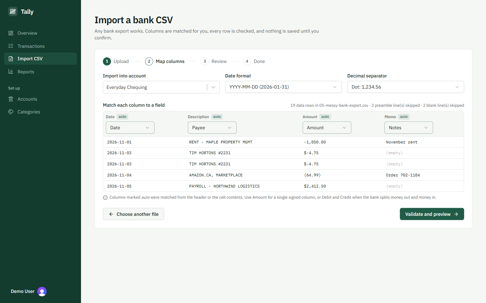
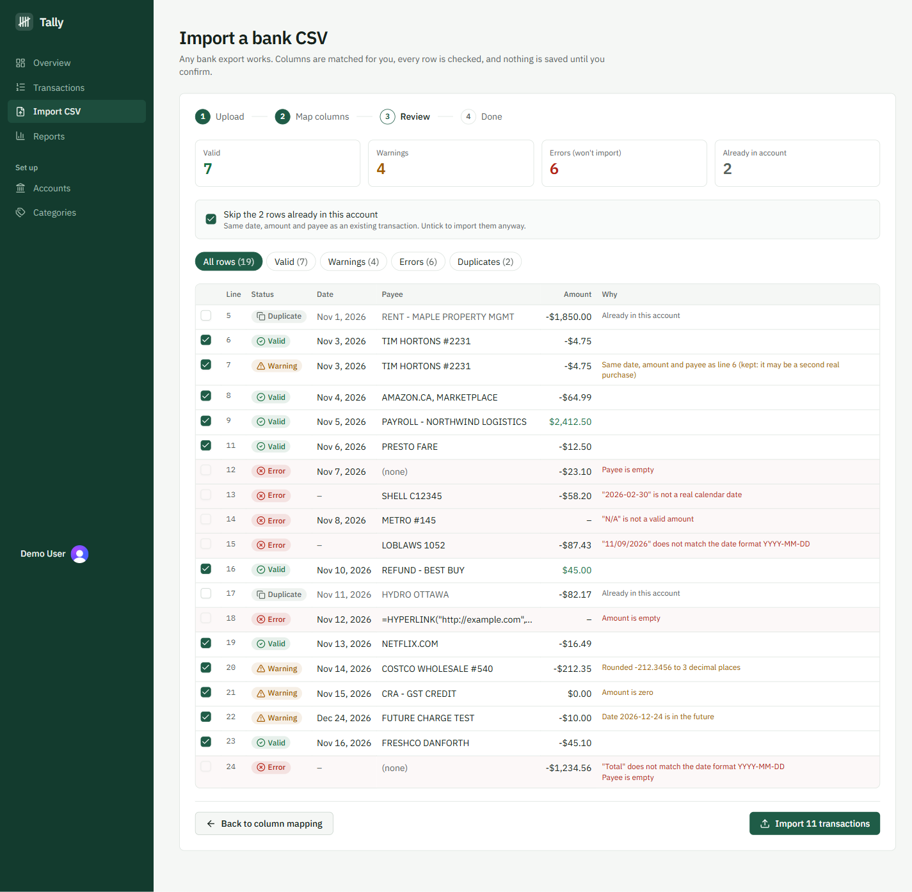
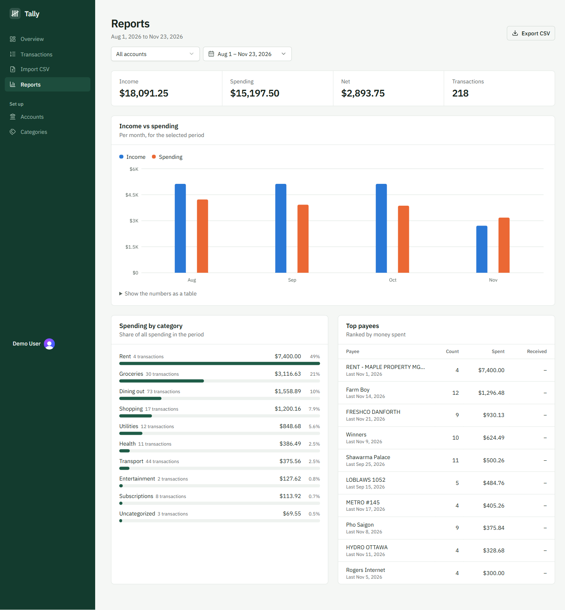
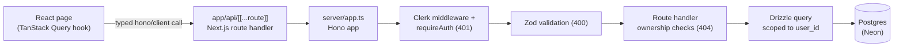

# Tally

A personal finance tracker built around one careful job: getting messy bank CSV exports into clean, checked transactions.

Every bank exports CSV differently: different columns, date formats, sign conventions, preambles and footers. Tally lets you map any export to its fields, shows every row as valid, warning or error with the exact reason, spots transactions you already have, and only saves what you confirm. On top of that data it gives you an overview and reports by category, month and payee, which you can export back to CSV.



## Features

All of these were tested by hand in the browser against the seeded demo data, as well as by the automated tests listed below.

- **CSV import with column mapping.** Upload any bank CSV. Columns are matched automatically from 70 common header names (e.g. "Transaction Date", "Description 1", "CAD$", "Withdrawals"), or from the cell contents when the file has no header row. You can change any mapping.
- **Preview before import.** Every row gets a status (valid, warning, error, or already in the account) and a plain-language reason. Filter by status, and include or exclude rows before anything is saved.
- **Validation and cleansing.** Six date formats with flexible separators, `$`, thousands separators, decimal commas, `(parentheses)`, trailing minus and DR/CR amounts, separate debit/credit columns, whitespace cleanup, blank lines and bank statement preambles skipped.
- **Duplicate detection.** Rows that match a transaction already in the account (same date, amount and payee) are flagged and skipped by default.
- **Import summary.** "X imported, Y skipped as duplicates, Z rejected", plus a downloadable CSV of every skipped row with its original line number and the reason.
- **Reports.** Income, spending and net; income vs spending per month; spending by category with shares; top payees. Filter by date range and account, and export the filtered transactions to CSV.
- **Overview dashboard** with change vs the previous period, a daily cash-flow chart and spending by category. A new user with no data sees an "Import your first bank CSV" screen instead of empty charts ([screenshot](docs/screenshots/empty-state.png)).
- **Accounts, categories and transactions**: create, edit, delete and bulk delete, with search and sorting.
- **Per-user data.** Every API query is scoped to the signed-in user, and writes check that the target account and category belong to them.
- **Responsive and keyboard accessible.** Sidebar on desktop, menu on mobile, labelled controls, visible focus, a skip link, and status shown with icons and words rather than colour alone.

| Import: column mapping | Import: preview with validation errors |
| --- | --- |
|  |  |



## How the CSV import validates and cleans data

The import logic lives in [`lib/import`](lib/import) as plain TypeScript functions with no React and no database, so every rule is unit-tested.

1. **Read the file** ([`csv.ts`](lib/import/csv.ts)). Strip a UTF-8 byte-order mark, detect the delimiter (comma, semicolon, tab or pipe), drop blank lines and count them. Skip statement preambles like `Statement for account ****4821` by finding the first row that reads like a header. If the first row is already data (it holds a date and an amount), treat the file as headerless. Keep each row's original line number for error messages.
2. **Map columns** ([`columns.ts`](lib/import/columns.ts)). Match headers against 70 aliases, and never map "Balance" or "Account Number" as the amount. Without a header, infer columns from their contents: a column that is 80%+ dates is the date; two neighbouring number columns where each row fills exactly one of them are debit and credit.
3. **Detect formats** ([`dates.ts`](lib/import/dates.ts), [`amounts.ts`](lib/import/amounts.ts)). Pick the date format that parses the most sample rows. If no day is above 12, `03/04/2026` could be March 4 or April 3, so the UI warns and asks you to confirm. Detect a decimal comma (`1.234,56`) from the samples.
4. **Validate and cleanse each row** ([`validate.ts`](lib/import/validate.ts)):
   - Dates: "does not match the date format" is reported separately from "is not a real calendar date" (`2026-02-30`). Future dates are a warning.
   - Amounts are parsed **as text, never as floating point**, into integer milliunits ($12.34 → 12340). Rejections say why: `"N/A" is not a valid amount`, `looks like it uses a decimal comma`, or too large for the database column.
   - Payee and notes are trimmed, inner whitespace is collapsed and the length is capped. An empty payee is an error.
   - A row with any error is rejected; a row with only warnings can still be imported.
5. **Find duplicates** ([`duplicates.ts`](lib/import/duplicates.ts)). The server returns the account's existing transactions in the file's date range. Rows match on date + amount + normalized payee (case, accents, punctuation and spacing ignored), **one-to-one**: if you already have one $4.75 coffee that day and the file has two, only one is a duplicate. Identical rows within the same file are flagged as a warning but kept, since they can be two real purchases.
6. **Import and report** ([`report.ts`](lib/import/report.ts)). The server re-validates every row with Zod and checks account ownership, then inserts in one statement (all or nothing). Skipped rows can be downloaded as CSV with a `Line` and `Reason` column ahead of the original columns. Spreadsheet formulas are escaped so the file is safe to open in Excel, while negative amounts like `-12.50` are left alone.

Try it with the files in [`public/samples`](public/samples), which you can also download from the import page:

| File | What it exercises |
| --- | --- |
| `01-clean-iso-dates.csv` | The happy path |
| `02-chequing-two-description-columns.csv` | M/D/YYYY dates, `Description 1/2`, a `CAD$` column, CRLF line endings |
| `03-no-header-debit-credit.csv` | No header row, debit/credit columns, ambiguous dates |
| `04-semicolon-decimal-comma.csv` | Semicolons, DD.MM.YYYY, `1.234,56` |
| `05-messy-bank-export.csv` | BOM, preamble, blank lines, `$`, `(64.99)`, `12.50-`, DR/CR, empty payee, `2026-02-30`, `N/A`, a formula in a payee, a "Total" footer |

## Tech stack

Next.js 14 (App Router) · TypeScript · Hono (API) · Drizzle ORM · PostgreSQL on Neon · Clerk (auth) · TanStack Query · Tailwind CSS 4 with shadcn/ui and Radix · Recharts · Papa Parse · Zod · Bun (runtime, package manager, test runner) · PGlite and fast-check (tests) · GitHub Actions (CI)

## Architecture



- **UI → API.** Pages call hooks in `features/*/api`, which use Hono's typed client (`lib/hono.ts`). Request and response types come straight from the server routes, so a changed endpoint is a compile error in the UI.
- **API.** `app/api/[[...route]]/route.ts` hands every `/api/*` request to the Hono app in `server/app.ts`. Each route module in `server/routes` runs `requireAuth` (Clerk session → `userId`, otherwise 401), validates params, query and body with shared Zod schemas from `lib/schemas.ts` (400 with the reason), then runs Drizzle queries that join through `accounts.user_id`. Writes that reference an account or category first check it belongs to the caller (`server/lib/ownership.ts`), and answer 404 otherwise.
- **Data.** Amounts are integers in milliunits; transaction dates are Postgres `DATE` values handled as `yyyy-MM-dd` strings, so no time zone can shift a day. Schema and migrations live in `db/schema.ts` and `drizzle/`.
- **Pages.** Dashboard pages are protected twice: by the middleware, and by `auth.protect()` in the dashboard layout.

## Run it locally

Prerequisites: [Bun](https://bun.sh), a Postgres database (a free [Neon](https://neon.tech) project works) and a [Clerk](https://clerk.com) application.

```bash
bun install
cp .env.example .env.local      # then fill in the values below
bun run db:migrate              # create the tables
bun run dev                     # http://localhost:3000
```

| Variable | What it is |
| --- | --- |
| `DATABASE_URL` | Postgres connection string |
| `NEXT_PUBLIC_CLERK_PUBLISHABLE_KEY`, `CLERK_PUBLISHABLE_KEY` | Clerk publishable key |
| `CLERK_SECRET_KEY` | Clerk secret key |
| `NEXT_PUBLIC_CLERK_SIGN_IN_URL`, `NEXT_PUBLIC_CLERK_SIGN_UP_URL` | `/sign-in`, `/sign-up` |
| `NEXT_PUBLIC_CLERK_SIGN_IN_FALLBACK_REDIRECT_URL`, `..._SIGN_UP_...` | `/` |
| `NEXT_PUBLIC_APP_URL` | `http://localhost:3000` |

**Demo data.** Sign up in the app, copy your Clerk user id (Clerk dashboard → Users, it looks like `user_2abc…`), then:

```bash
SEED_USER_ID=user_2abc... bun run db:seed
```

This deletes and recreates **only that user's** accounts, categories and transactions: three accounts, ten categories and about four months of transactions. Random choices use a fixed seed, so runs on the same day produce the same data.

**Checks** (the same four steps CI runs on every push):

```bash
bun run typecheck
bun run lint
bun run test       # 214 tests
bun run build
```

The 214 tests break down as:
- **122 import tests:** parsing, column detection, dates, amounts, cleansing, duplicates, the skipped-rows report, and the sample files end to end. They include property-based tests: any amount printed in six bank styles parses back exactly, and duplicate matching never reuses a transaction.
- **45 API tests:** they run the real Hono app against an in-process Postgres (PGlite) with every migration applied. They cover that a user can't read or write another user's accounts, categories or transactions, and check the report numbers to the cent against hand-computed fixtures.
- **47 unit tests:** dates, milliunit conversions and report helpers.

Tests run in the America/Toronto time zone, so an off-by-one-day UTC bug fails them.

## What I'd improve next

- **Categories during import:** map a category column, or remember rules by payee ("TIM HORTONS → Dining out").
- **Saved import profiles** per bank, so the second import from the same bank needs no mapping.
- **Transfers between your own accounts** are currently counted as income and spending. Link both sides and exclude them from reports.
- **Larger amounts and more currencies:** amounts are 32-bit integers (max $2,147,483.647 per transaction) in a single currency (CAD).
- **Parse on the server too**, for very large files and for imports through an API rather than the browser. Today the browser parses the file; the server re-validates every row and checks ownership.
- **Browser tests in CI** (Playwright) for the import flow, which is currently verified by hand.
- Dark mode, and dropping the unused `plaid_id` columns.

## Credits

The starting point was the stack and structure of Code With Antonio's "Finance SaaS Platform" tutorial (Next.js, Hono, Drizzle, Clerk). The CSV import pipeline, reports, data validation, authorization fixes and tests, the date-handling rework, the seed script and the visual design were added on top of it.
